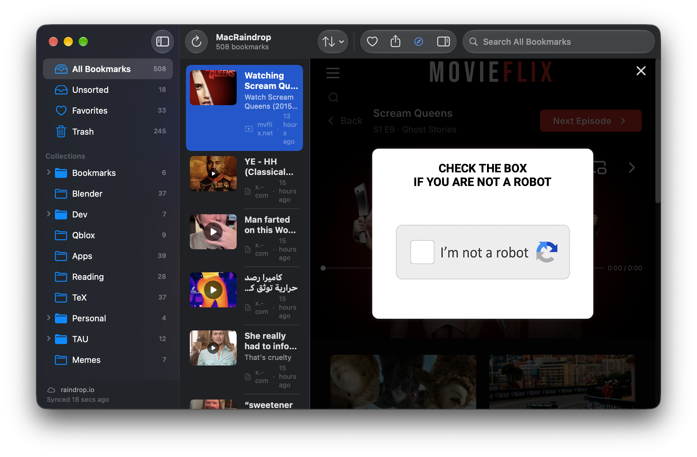

# MacRaindrop

A native SwiftUI client for [Raindrop.io](https://raindrop.io) bookmarks on macOS.



## Features

- Sidebar with All, Unsorted, Favorites, Trash, nested collections and tags
- Searchable, sortable bookmark list; double-click opens a bookmark in your browser
- The bookmarked page itself in a built-in web view, with details (note, tags, highlights, info) in an inspector
- Hiding the sidebar also hides the list, leaving just the page
- Local SwiftData cache, so the library appears instantly at launch
- Incremental sync: nothing is fetched when the server reports no changes, only recent changes otherwise, and a full refetch when something was deleted

## Running

Requires Xcode 27 and macOS 27.2 or later.

Without a token, the app shows the bundled sample data in `MacRaindrop/SampleData`.

To use your own library, create a test token in Raindrop's [integration settings](https://app.raindrop.io/settings/integrations) and provide it as `RAINDROP_TEST`:

- In Xcode: Edit Scheme → Run → Arguments → Environment Variables.
- Or launch a built app from the terminal:

  ```bash
  open --env RAINDROP_TEST="$RAINDROP_TEST" MacRaindrop.app
  ```

## Known issue

Running under Xcode's debugger can crash at launch with *"The window has been marked as needing another Update Constraints in Window pass…"*. The cause is a `NavigationSplitView` nested inside another one, which the layout uses to hide the list together with the sidebar. A minimal app containing only that nesting crashes the same way on the current macOS beta. Launching the built app normally works.

## Layout

| Path | Contents |
| --- | --- |
| `MacRaindrop/Models` | Codable types mirroring the Raindrop REST API |
| `MacRaindrop/Data` | API client, sample-data service, SwiftData cache, sync engine, store |
| `MacRaindrop/Views` | Sidebar, list, detail/inspector views |
