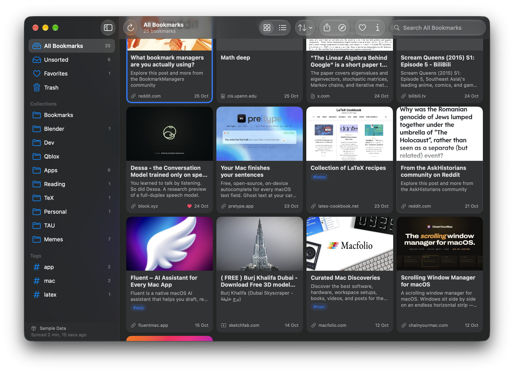
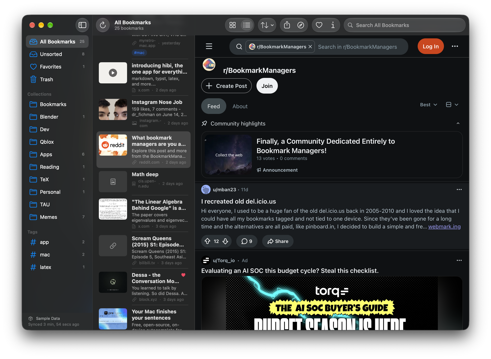

# MacRaindrop

A native SwiftUI client for [Raindrop.io](https://raindrop.io) bookmarks on macOS.


%%
%%


## Features

- Sidebar with All, Unsorted, Favorites, Trash, nested collections and tags
- Two modes: a cards grid, or a list with the bookmarked page in a built-in web view
- Cards select like Finder icons (click, ⌘/⇧-click, rubber band, arrow keys) and drag out as links; double-click opens a bookmark in your browser
- Searchable and sortable in both modes, with details (note, tags, highlights, info) in an inspector
- Local SwiftData cache, so the library appears instantly at launch
- Incremental sync: nothing is fetched when the server reports no changes, only recent changes otherwise, and a full refetch when something was deleted

## Running

Requires Xcode 27 and macOS 27.2 or later.

On first launch the app asks for a test token, which you create in Raindrop's [integration settings](https://app.raindrop.io/settings/integrations) ([how](https://developer.raindrop.io/v1/authentication/token)). It's saved in the app's user defaults; replace or remove it in Settings (⌘,). Debug builds also offer the bundled sample data in `MacRaindrop/SampleData`.

A `RAINDROP_TEST` environment variable wins over the saved token, for pointing a scheme at another account (Edit Scheme → Run → Arguments → Environment Variables).

To build Release and replace the copy in `/Applications` (relaunching it if it was open):

```bash
scripts/install.sh
```

## Known issue

Running under Xcode's debugger can crash at launch with *"The window has been marked as needing another Update Constraints in Window pass…"*. The cause is a `NavigationSplitView` nested inside another one, which the layout uses to hide the list together with the sidebar. A minimal app containing only that nesting crashes the same way on the current macOS beta. Launching the built app normally works.

## Layout

| Path | Contents |
| --- | --- |
| `MacRaindrop/Models` | Codable types mirroring the Raindrop REST API |
| `MacRaindrop/Data` | API client, sample-data service, SwiftData cache, sync engine, store |
| `MacRaindrop/Views` | Sidebar, list, detail/inspector views |
