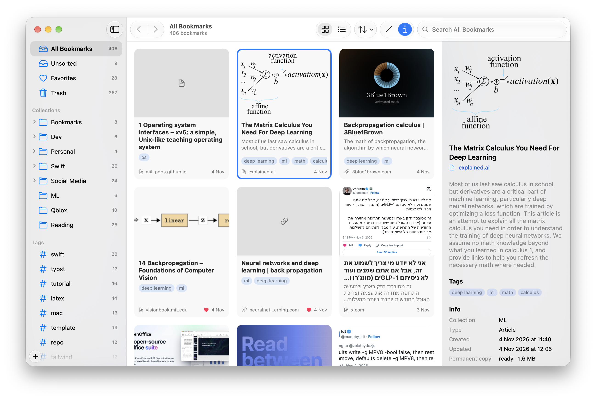
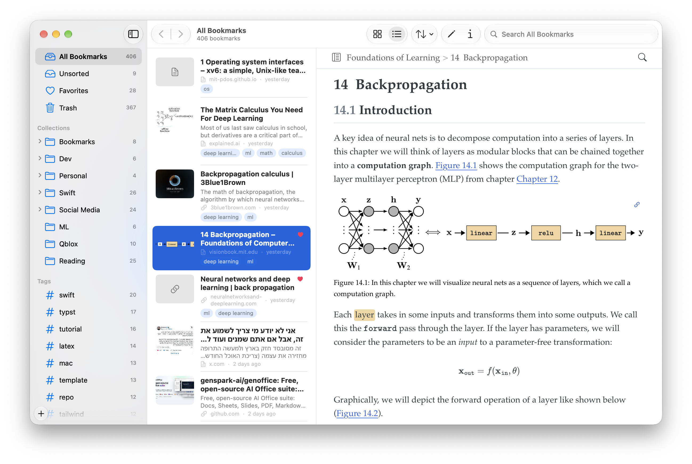

# MacRaindrop

A native SwiftUI client for [Raindrop.io](https://raindrop.io) bookmarks on macOS.



## Features

- Sidebar with All, Unsorted, Favorites, Trash, nested collections and tags
- Two modes: a cards grid, or a list with the bookmarked page in a built-in web view
- Cards select like Finder icons (click, ⌘/⇧-click, rubber band, arrow keys) and drag out as links; double-click opens a bookmark in your browser
- Searchable and sortable in both modes, with details (note, tags, highlights, info) in an inspector
- Local SwiftData cache, so the library appears instantly at launch
- Incremental sync: nothing is fetched when the server reports no changes, only recent changes otherwise, and a full refetch when something was deleted

### List View with in-App Browser

### Quick Search Panel

## Running

Requires Xcode 27 and macOS 27.2 or later.

On first launch the app asks for a test token, which you create in Raindrop's [integration settings](https://app.raindrop.io/settings/integrations) ([how](https://developer.raindrop.io/v1/authentication/token)). It's saved in the app's user defaults; replace or remove it in Settings (⌘,). Debug builds also offer the bundled sample data in `MacRaindrop/SampleData`.

A `RAINDROP_TEST` environment variable wins over the saved token, for pointing a scheme at another account (Edit Scheme → Run → Arguments → Environment Variables).

To build Release and replace the copy in `/Applications` (relaunching it if it was open):

```bash
scripts/install.sh
```

Closing the last window keeps the app running in the background without a Dock icon, so the Quick Search hotkey (⇧⌘L) still works. Open the app again (or ⌘-Return in Quick Search) to bring a window back; quit with ⌘Q while a window is open.

## Known issue

Running under Xcode's debugger can crash at launch with *"The window has been marked as needing another Update Constraints in Window pass…"*. The cause is a `NavigationSplitView` nested inside another one, which the layout uses to hide the list together with the sidebar. A minimal app containing only that nesting crashes the same way on the current macOS beta. Launching the built app normally works.

## Layout

The interface is SwiftUI. Cards mode is a `LazyVGrid`. Thin AppKit views fill the gaps SwiftUI leaves: grid keyboard focus (`GridKeyResponder`) and drag images that shrink over collection chips (`CollectionDropZone`).

Folders follow features, and each file is named after the type it holds. A `private` helper can share its only user's file. Anything used from another file gets its own file. A feature's main view is named after the feature (`GridView`, `ListView`, `InspectorView`); views of one item are named after the item (`RaindropCard`, `RaindropRow`, `CollectionTile`).

| Path | Contents |
| --- | --- |
| `MacRaindrop/` | App entry (`MacRaindropApp`, `AppDelegate`, `AppSession`), the window (`ContentView`, `ContentToolbar`), and its `NavigationModel`: location, history, selection, search |
| `MacRaindrop/Sidebar`, `Grid`, `List`, `Inspector` | The window's parts. `Grid` is cards mode; `List` is list mode and its page view |
| `MacRaindrop/Commands` | Menu bar commands |
| `MacRaindrop/Actions` | Bookmark actions menu, the prompts they raise (`ActionPrompts`), and their sheets |
| `MacRaindrop/DragAndDrop` | Drop targets, the moves they make (`LibraryDrop`), and dragging bookmarks out |
| `MacRaindrop/QuickSearch` | The ⇧⌘L panel |
| `MacRaindrop/Account` | Token prompt and Settings › Account |
| `MacRaindrop/Models` | Codable types mirroring the Raindrop REST API, plus `SidebarItem` and `RaindropSort` |
| `MacRaindrop/Library` | `LibraryStore` and what keeps it: SwiftData cache, sync engine, search index, automatic sync |
| `MacRaindrop/Services` | API client, sample-data service, image pipeline |
| `MacRaindrop/Shared` | Views used across features (`CoverImage`, `TagList`, `FlowLayout`), display helpers, and `previewEnvironment()` |

Previews live with the view they preview. The sidebar's are the exception, in `SidebarView+Previews.swift`, because previewing a sectioned `List` from its own file crashes the canvas.
